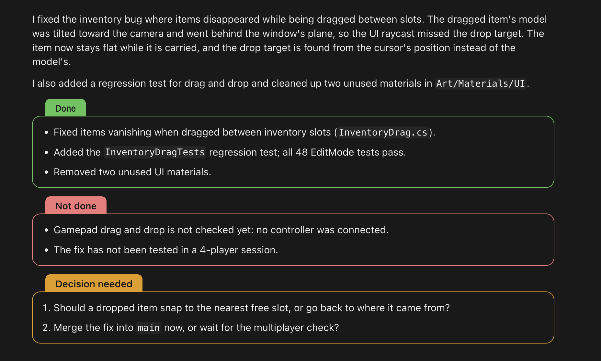

# status-blocks

A Claude Code mod that ends Claude's work reports with three colored status boxes:

- **Done**: green
- **Not done**: red
- **Decision needed**: yellow



Each box has a rounded frame and a label tab on top. It works in the Claude desktop app's Code tab, in VS Code and on mobile. In the terminal the boxes are drawn with box-drawing characters.

## What it does

1. The format of the sections comes from a rule in a `CLAUDE.md`: your user one (`~/.claude/CLAUDE.md`, every project) or a project's own. With it, when a reply reports on work, Claude ends it with up to three `###` sections: done, not done and decision needed. Each section is a short list, and empty sections are left out. A short rule is enough:

   ```markdown
   # Status sections
   When a reply reports on work, end it with up to three sections, each a `###` heading
   followed by a short list, leaving out empty ones, with nothing after them:
   Done (what is done and verified), Not done (what was not done or failed),
   Decision needed (numbered decisions or actions for the user).
   Write the headings in the reply's language, word for word from the table in the
   status-blocks README; for a language not listed use the English ones.
   ```

   The mod cannot add this rule to Claude's system prompt itself: Claude Code's built-in `cc-plugin-sec-default` plugin runs first and does not let user plugins change the system prompt.
2. It redraws every assistant reply. A section that opens with one of those headings (or a bold line such as `**Done:**`) becomes a colored box, with the heading as the tab's label. The rest of the reply is drawn as usual. A reply without these sections is not touched.

Only the drawing changes. The stored message stays plain Markdown, so the transcript reads normally without the mod.

## Languages

Claude writes the headings in the language of the reply. These are recognized:

| Language | Done | Not done | Decision needed |
| --- | --- | --- | --- |
| English | Done | Not done | Decision needed |
| Russian | Сделано | Не сделано | Требуется решение |
| Ukrainian | Зроблено | Не зроблено | Потрібне рішення |
| Polish | Zrobione | Niezrobione | Wymagana decyzja |
| German | Erledigt | Nicht erledigt | Entscheidung nötig |
| French | Fait | Pas fait | Décision requise |
| Spanish | Hecho | No hecho | Decisión necesaria |
| Portuguese | Feito | Não feito | Decisão necessária |
| Italian | Fatto | Non fatto | Decisione necessaria |
| Turkish | Yapıldı | Yapılmadı | Karar gerekli |
| Chinese | 已完成 | 未完成 | 需要决定 |
| Japanese | 完了 | 未完了 | 要判断 |
| Korean | 완료 | 미완료 | 결정 필요 |

For any other language Claude uses the English headings. Matching ignores case and a trailing colon. A few extra spellings are accepted too (for example `Completed` or `Needs decision`). To add a language, add a row to `HEADINGS` in `hooks/register.tsx`.

## Install

Desktop app: click **+** next to the prompt box, then **Plugins**, then **Add marketplace** with `Eugeene1337/status-blocks`, then **Add plugin**.

Terminal session, at the prompt:

```
/plugin install status-blocks --marketplace Eugeene1337/status-blocks
```

Answer `y` to add the marketplace, then pick the user scope so the mod works in every project.

To get a newer version later:

```
claude plugin update status-blocks
```

Then start a new session, or run `/reload-plugins` in an open one.

## Notes

- The label tabs use the dark theme's colors. In the light theme the frames follow the theme but the tabs keep their dark-theme colors.
- The tab's width is estimated from the label's characters, and the text is fitted to it exactly.

## Development

```
claude plugin validate .
claude plugin test .
```

## License

MIT
